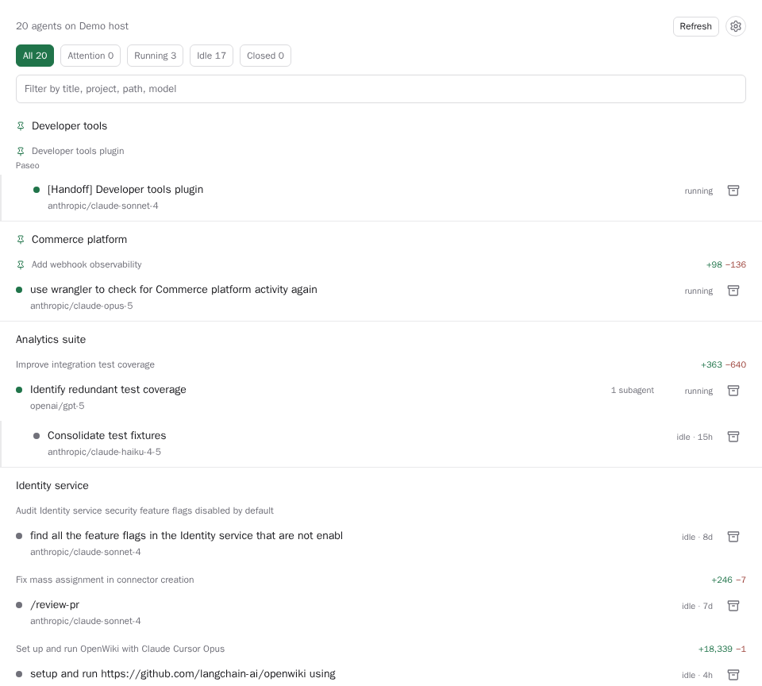
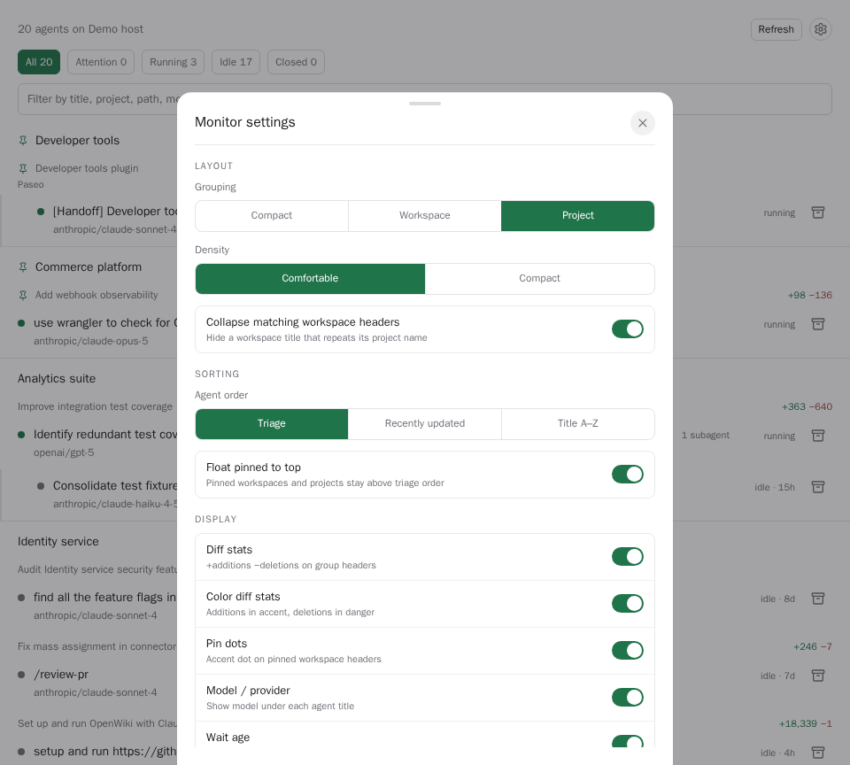

# agent-monitor

One roster for every agent on a daemon: an `Agent monitor` screen in the sidebar plus a global
Command Center item (`Open agent monitor`). The sidebar row also counts the agents
that need attention.

Answers "which of my 38 agents needs me right now" without walking the workspace tree.

## Demo

https://github.com/user-attachments/assets/3c841799-ed98-4ec4-86a0-a7917e3894fc

## Screenshots

Agent, project, and workspace names come from an isolated synthetic workspace. The roster and
settings PNGs were captured at 2× pixel density after browser DevTools replaced the local host
label and verified that no private organization names remained in the rendered page. The graph
screenshot uses the same synthetic project and agent names.

### Project-first roster



### Graph view


### Monitor settings



## What it shows

- Counts and filters by triage bucket: Attention, Running, Idle, Closed. Attention covers
  `requiresAttention`, `status === "error"`, and pending permission requests.
- Grouping and sort are separate. The **Group** row switches the roster between **Project**,
  **Workspace**, **Host**, **Type** and **None** (flat), and the **Sort** row orders rows inside
  every group: **Triage**, **Recent** or **A-Z**. Each chip carries its key: `P`/`W`/`H`/`Y`/`N`
  group, `S`/`E`/`Z` sort. Host and Type groups collapse and expand like project headers. Choices
  save in the host settings. Open the gear beside Refresh for the host-native Monitor settings
  screen, which exposes the same grouping and sort (plus the rest of the display options).
- Settings also control float-pinned sorting, agent sort (triage / recently updated / title),
  collapse of matching workspace headers, density, default bucket, whether Closed stays out of
  All, and display toggles for diffs, pin markers, model, wait age, subagent counts, last error, and
  compact placement. Preferences are a typed, host-scoped document shared by connected clients.
- Workspace headers show up to two workspace labels and current `+additions −deletions`
  (additions in the success color, deletions in danger when color diffs are on).
- Per row: a status dot that separates errors (danger) from agents waiting on you (warning) and
  running agents (success), state and wait age on a right-aligned rail (`attentionTimestamp`,
  falling back to `updatedAt`), model, and `lastError` inline.
- Parent rows show their subagent count; child rows use a left indent guide.
- Agents delegated from another host (`paseo.parent-server-id` names a different host) are listed as top-level rows with a "Delegated from `<host>`" hint. They are never counted under, or indented below, a local agent that happens to share the parent id.
- Text filter over title, agent id, provider, model, cwd, project, and workspace.
- **Graph view**: switch the header between Roster and Graph. Agents sit in compact
  project/workspace panels; provider-native subagents appear as dashed nodes. Edges encode parent
  hand-offs, timeline message provenance, and subagent dispatches, with thickness scaled by message
  count. Drag cards, pan the canvas, zoom with the wheel or a trackpad pinch, filter by project,
  workspace, provider, subagents, or connected-only, and select a card or edge to focus its
  neighbourhood and dim the rest.
- Select an agent row to open that agent, or select a workspace header (or its folder button when
  collapsed) to open its workspace through Paseo's cross-platform navigation API.
- Archive one agent, or sweep every closed agent (two taps).
- **Multi-host**: when the client connects to more than one host, the monitor merges every online
  host into one screen. The header counts agents across hosts, host chips filter the roster, rows
  show their host in compact placement lines, and project groups merge by base name so one project
  reads as one group (a per-host display suffix such as `ACME · alpha` does not split the group).
  The graph adds a host filter row, shows the host in node details, and opens agents and workspaces
  on their own host through the navigation `serverId`. Timeline sweeps run per host and merge, and
  archive fans out to the owning host of each agent. A host that fails to load is named in a
  warning while the rest keep working; the sidebar badge counts every online host. Graph cards and
  workspace headers carry a host pill in the host's color when more than one host is shown, panels
  spanning hosts list them, and project headers name their hosts.
- **Agent overview**: a Mission Control grid with every running or attention-needing agent, summoned
  from the command center. `1-9` jump straight to an agent, `Tab` or arrows move the selection,
  `Enter` opens, `Esc` backs out. `Next agent` / `Previous agent` commands cycle the same list with
  wraparound. Inside the monitor, `R`/`G`/`O` switch Roster, Graph and Overview, and `A`/`T`/`U`/`I`/`C`
  pick All plus the four buckets; digits stay reserved for jumping straight to agents.
- On Paseo 0.14 and later, eligible idle resumable agents are released after about an hour and appear in
  Closed (active work, descendants, pending finish notifications and provider safety checks keep a
  runtime resident). They keep their record and resume on the next prompt, so **Archive N closed** archives
  them too. Set `agents.idleRuntimeCleanup: false` in the host config to disable the release.
- On Paseo 0.15, restart recovery is off by default and agents that were running when the host stopped or
  crashed stay in Closed. With `agents.resumeOnStartup: true` in the host config, eligible ones are resumed
  in the background; **Archive N closed** then archives any that have not resumed yet, which cancels their resume.

## Sidebar row

- The row's badge counts the Attention bucket across every online host, using the same rule as
  the roster. It shows no number while the roster loads or when a failed host leaves no rows, and
  `N+` when any host truncates or fails (the missing rows might need attention). The count drops
  its lower bound once a failed host recovers.
- Press the badge for the Mission Control overlay: running and attention-needing agents across
  hosts, grouped with number badges (attention first, longest waiting). `1-9` jump straight to an
  agent, `Tab` moves, `Enter` opens it directly, `Esc` dismisses the overlay. **Open monitor**
  opens the roster filtered to Attention.
- The monitor screen accepts a `bucket` param (`attention`, `running`, `idle`, `closed`, or `all`)
  as its initial filter, so a link such as `…/surface/monitor?param.bucket=attention` opens
  filtered and keeps that filter on reload. Chips then filter in place without changing the URL.

## How it reads state

Each online host is read through its own existing client (`getPaseoClient(serverId)`):
`agents.list()` pages the daemon agent directory, `workspaces.list()` reads workspace pin state,
project id, and diff stats (200 per page, up to 10 pages each), and `projects.list()` supplies
registered project names, including custom renames, so an agent whose workspace is beyond the
paged workspace list still lands under its real project. Rows refresh from agent, workspace, and
project subscription deltas on every host, debounced 750ms, with a 30s backstop refetch. The
screen, the sidebar row, and its popover share that query, subscription set, and backstop; on web
and desktop, refreshes pause while the window is hidden and catch up when it returns. The plugin
opens no socket of its own. Agents and workspaces in background workspaces are included.

The graph reads timeline tails (200 entries, up to 60 agents per host, four at a time) to derive message
and subagent edges. It refreshes every 30 seconds while open in the foreground and when Refresh
is pressed. Readable closed timelines can contribute interactions; unreadable timelines are
counted in the graph toolbar. Filters only change the visible graph and do not start new scans.
Each host's timelines are swept through that host's client and merged. Graph filters, selection, and positions
are temporary; the existing host-scoped monitor settings are unchanged.

## Limits

Interrupting a turn is not part of `PaseoApi`, so archive is the only lifecycle action here.

Popovers get no navigation, so a popover row reaches an agent through the monitor screen,
which hands off to the agent as it mounts. The handoff runs on a tick past the route commit: a
navigate dispatched while the pushed monitor route is still being committed is dropped by the
router. If the handoff cannot happen, the monitor renders normally instead of leaving a blank
screen; on hosts without navigation the same tap selects the agent's card in the graph.

## Install

Requires Paseo `^0.13.0 || ^0.14.0 || ^0.15.0`, whose background workspaces the monitor lists. Development uses the 0.15 SDK line from the workspace catalog.

Install the published package on the daemon host:

```bash
paseo plugin install npm:@omercnet/paseo-agent-monitor
paseo plugin update agent-monitor
```

## Install on more than one host

The monitor reads every online host no matter which installation renders it, so install it on each
host whose client should keep working when the others are unreachable. The app groups the sidebar
row by plugin and the surface keeps a host switcher, so two installs never show two rows.

What stays per installation:

- Settings (`scope: "host"`): grouping, sort, density, the default bucket and the display toggles
  live on each host. Change them on both sides if you want them to match.
- The bundle: reload every host after each change (`paseo plugin reload agent-monitor` on each
  daemon) and keep both clones on the same commit. A stale bundle renders with old behavior, and
  the only symptom is the surface behaving differently per selected host.

A daemon with plugins disabled rejects plugin calls; enable once with `"pluginsEnabled": true`
in its `config.json` followed by `paseo reload`. Removing one side later is
`paseo plugin remove agent-monitor` on that host.

## Develop

```bash
bun install
bun run check
bun run test
bun run test:coverage
bun run typecheck
```

Release Please maintains the version, changelog, component tag, and GitHub release from
Conventional Commits in the monorepo.

The project supports Paseo `^0.13.0 || ^0.14.0 || ^0.15.0` and pins `@getpaseo/plugin`, `@getpaseo/client`,
`@getpaseo/protocol`, and `@getpaseo/cli` to the 0.15 SDK line through the workspace catalog. Renovate groups `@getpaseo/*`
updates so the SDKs move together.

React `19.1` and React Native `0.81` intentionally match the versions supplied by Paseo.
