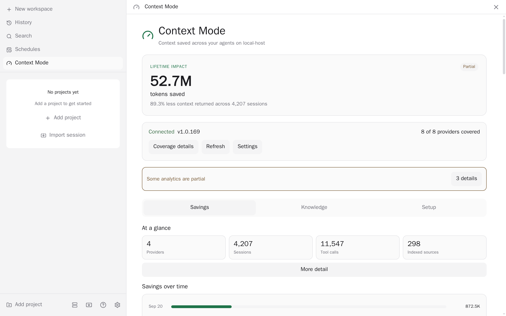
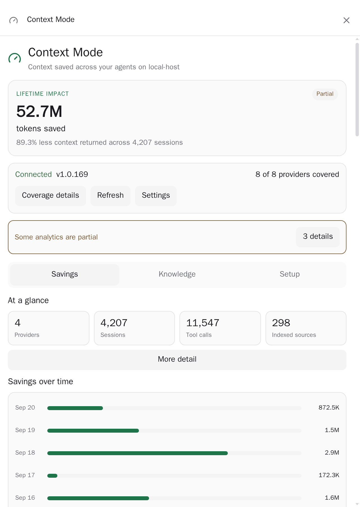

# Paseo Context Mode

A Paseo sidebar and provider integration for [Context Mode](https://github.com/mksglu/context-mode). It bundles a pinned Context Mode runtime, shows health and savings, and activates Context Mode for supported Paseo agents without replacing existing provider-native integrations.

## Demo

https://github.com/user-attachments/assets/43065ede-3fbd-4a9c-b1bb-79d327d90d9b

## Screenshots

These previews were captured from an isolated Paseo test daemon with Context Mode installed on a disposable home. The browser opened the real plugin surface on the daemon's Tailscale address, and both PNGs are 2× captures of the live data-backed UI.

### Wide surface



### Compact surface



## Current scope

- Bundles Context Mode 2.1.4 as a runtime dependency; a separately installed global executable remains optional.
- Resolves a configured absolute executable first, then the daemon's `PATH`, then the bundled runtime. A global Context Mode 1.x is skipped in favor of the bundled 2.x runtime, since 1.x starts a server but lacks the 2.x tool contracts.
- Shows Context Mode version, structured diagnostics, provider activation, the data directory, lifetime savings, activity, per-agent and per-project breakdowns, categories, and indexed sources. `ctx_stats` and the Setup tab run against a plugin-owned probe store (`<PASEO_HOME>/plugin-data/context-mode/probe`) so they never write into your real project databases; it starts empty.
- Reads Context Mode 2 `context.db` files (`<data dir>/projects/<key>/context.db`, schema `user_version` 6) in query-only mode, honors active WAL state, isolates corrupt or locked databases, and reports partial coverage instead of mutating schemas. The data directory is `CONTEXT_MODE_DATA_DIR`, else `~/.context-mode`.
- Injects the bundled stdio MCP server (`context-mode server --agent <id>`, with the data directory pinned to the one the dashboard reads) into new Claude, Codex, Copilot, and OpenCode agents through Paseo's `agent.create` hook. Cursor, Pi, and OMP are shown as disabled: Context Mode 2 dropped Cursor and OMP, and runs inside Pi only as its own in-process extension (`pi install npm:context-mode`).
- Preserves existing MCP servers and explicit environment overrides.
- Prefers detected native provider integrations to avoid duplicate `ctx_*` tools.
- Context Mode 2 keeps one database per project, shared by every agent, so storage is no longer isolated per provider.
- Provides project-scoped knowledge search (worktree or project scope, relevance or timeline order, with a More results button that follows upstream's page cursor), local-path indexing, URL indexing, indexed-source visibility with per-source forget, and a Recent sessions list on the dashboard. A session row can show Context Mode's `ctx_resume` state block (the last task, changed files and open errors an agent gets after a compact or restart) or forget that session. Index labels are chosen by Context Mode (the project-relative path or the final URL), so only content indexed by an agent carries a custom label. The agent selected in Knowledge only labels the Context Mode process; the project path decides which database is used. Plugin-initiated calls share one fixed `paseo-context-mode` session, which the sessions list leaves out.
- Requires an explicit provider, project path, scope review, and second confirmation before forgetting a project, session, or source. Deletion remains delegated to Context Mode's own `ctx_purge` contract.
- Returns structured install and upgrade argv for review, with a follow-up setup command when needed; Paseo never executes those commands automatically.
- Registers the `context-mode` screen with URL-persisted `section`, `agentId`, and `workspaceId` params. Composer pills open Knowledge using the selected host's agent provider and working directory. URL params never carry paths or queries.
- Providers that Context Mode does not support, and missing agents or mismatched workspaces, require explicit scope selection.
- Adds a live Healthy/Failing sidebar footer row, reusing the screen's health data.

Upgrading from 3.x: Context Mode 2 is a rewrite with a new storage layout. The plugin only reads 2.x databases; existing 1.x data under provider directories is left untouched and is not shown. Agents created by an older plugin version keep a saved MCP entry that points at the removed 1.x entry file, so recreate them to pick up the new server. Run Context Mode's own `context-mode setup` if you also use it natively.

## Prerequisites

Node.js 24.15 or later is required by this plugin and by Context Mode 2. The bundled Context Mode runtime is installed with the plugin. Native provider integrations remain recommended because generic MCP injection provides tools but cannot add provider-native lifecycle hooks.

The plugin depends on the upstream `context-mode` npm package under the Elastic License 2.0. See [NOTICE](NOTICE).
## Install

Install the published npm package on the daemon host:

```bash
paseo plugin install npm:@omercnet/paseo-context-mode
```

Update an npm installation to the latest published release:

```bash
paseo plugin update context-mode
```

The npm install and update flow requires Paseo `^0.12.0 || ^0.13.0 || ^0.14.0 || ^0.15.0` with npm available on the daemon host.


## Commands and limits

The daemon launches Context Mode directly with an argv array and no shell. MCP calls cover diagnostics, stats, search, indexing (path or URL), and explicitly confirmed purge. Each subprocess has a 192 KiB combined output cap and a per-tool timeout: 15 seconds for stats, 20 for search and resume, 30 for doctor, and 120 for indexing, purge, execute, batch, and upgrade. The version and tool-list handshake has a 12-second timeout. Status is cached for 10 seconds and raw stats for 5 seconds.

Install and upgrade actions return separate program and argument fields. They are displayed for review and never executed by the plugin. Older Context Mode builds that lack required tools are reported as unsupported. Missing executables, launch failures, timeouts, protocol errors, output limits, unsupported database schemas, locked databases, and partial database scans are surfaced as typed states or warnings.

## Development

```bash
bun install
bun run typecheck
bun run test
bun run check
```

## Licensing and attribution

The plugin is MIT licensed. Context Mode is a separate project by Mert Koseoglu and contributors, distributed under the Elastic License 2.0. See [NOTICE](NOTICE).
