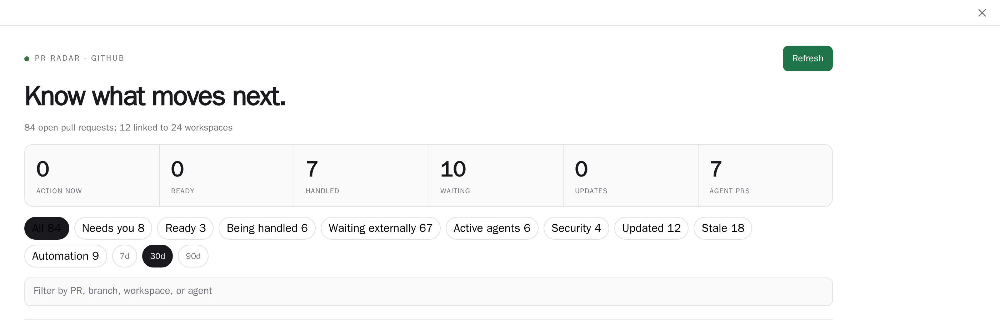
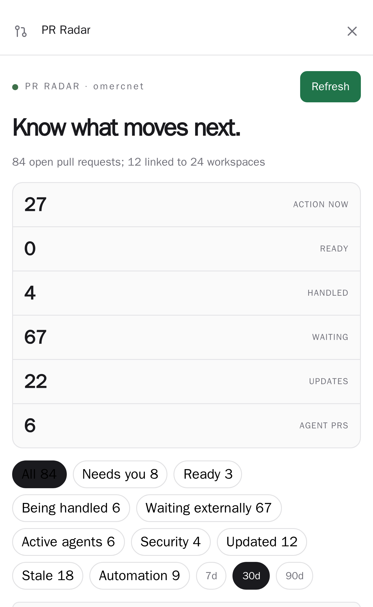

# PR Radar

A Paseo plugin that turns pull requests linked to active workspaces into a viewer-aware delivery queue.

PR Radar combines Paseo workspace and agent state with pull request checks, review status, mergeability, and the current GitHub user's relationship to each pull request. It answers which deliverables need you, which are already being handled, and which are waiting elsewhere.

## Demo

https://github.com/user-attachments/assets/ce0b4d61-59ce-49cf-881e-132db58d3038

## Screenshots

Repository, pull request, workspace, and agent names are rewritten to synthetic values in browser
DevTools before capture. Both PNGs come from an isolated Paseo test daemon at 2× pixel density.

### Wide dashboard



### Compact dashboard



## What it shows

- Needs you: authored blockers and review requests whose checks have completed.
- Being handled: actionable work with an active Paseo agent.
- Waiting externally: running checks, pending reviews, repository requirements, and external-author work.
- Ready: authored pull requests that are mergeable with settled checks and reviews.
- Viewer labels: `YOURS`, `REVIEW`, and `EXTERNAL`.
- Working-directory tags: `CWD-WORKTREE`, `CWD-BASE`, and `CWD-TBD` (shown on rows and maintained as Paseo workspace/agent labels).
- Draft PRs (DPRs): displayed in a separate collapsible section below regular pull requests.
- Issues tab: switch between `Pull Requests` and `Issues` (authored by you, assigned to you, or in your owned repos) with the same `Start New Agent`, `Open Existing Agent`, `CWD-*` tags, `Copy link`, and `Open Issue` workflow.
- Action cluster on every PR:
  - `Open issues (N)`: opens all linked/closing GitHub issues in your browser when present.
  - `Start New Agent`: available on every PR (orange when a local checkout/worktree exists, brown when `CWD-TBD` and a clone or directory pick is needed). Opens an interactive directory/worktree chooser (supporting incremental typing, GUI selection, `CWD-WORKTREE` vs `CWD-BASE`, and one-click clone + worktree creation), or launches immediately when configured in Settings.
  - `Open Existing Agent`: jumps directly to an existing linked Paseo agent.
  - `Ask agent` / `Open workspace` / `Copy link` / `Open PR`.
- Settings (`PR Radar settings`): configure `sourceCodeDir` (default `~/src`), `defaultCwdMode` (`CWD-WORKTREE` or `CWD-BASE`), `autoLaunchMode` (`prompt`, `existing_only`, or `existing_or_clone`), default agent launch options (profile, provider, model, effort, mode, context mode), and an optional absolute/`~/` routing script path (copy `examples/pr-radar-route.py`, a small example of the stdin/stdout contract, to e.g. `~/.config/pr-radar/route.py` and edit it). The script path and `sourceCodeDir` are read from the saved settings on the server, never from the request. The script must be an executable regular file owned by you or root, in directories that group and others cannot write (a sticky directory such as `/tmp` is fine); it runs with a minimal environment, a 30 second timeout and a 1 MiB output cap, one at a time (not on Windows). It may set only the `default`, `plan`, `acceptEdits` and `read-only` permission modes and the `contextMode` option; other values are ignored and the launch notice says so. A profile it names is ignored too when that profile sets another permission mode, option or feature value. Directories outside `sourceCodeDir` are refused for clones, checkouts and worktrees. These checks are defense in depth against crafted requests, not a privilege boundary: the settings are the trust source, but any Paseo client can write them.

#### Routing script labels

A routing script may return `"labels": {"key": "value"}`, and PR Radar puts them on the agent it launches (next to its own `pr-radar.cwd`). The script reads PR text on stdin, so its labels are untrusted and are checked as a whole:

- **Namespaced by default.** A label key is stored as `pr-radar.route.<key>` (`{"kind": "external-review"}` becomes `pr-radar.route.kind=external-review`). The namespaced key must still fit the 128 character key limit.
- **Allowed label prefixes** (setting `routingLabelPrefixes`, empty by default; comma or space separated, for example `ade.`). A key that starts with one of them keeps its own name. Everything else stays namespaced. A prefix never admits a reserved key.
- **Always reserved:** `pr-radar`, `pr-radar.*` (including `pr-radar.cwd`, which PR Radar sets itself, and `pr-radar.route.*`, which only PR Radar writes), `paseo` and `paseo.*`, compared without regard to case. A script cannot set them; naming one is an invalid label.
- **Limits:** at most 16 script labels (PR Radar adds `pr-radar.cwd`, so an agent carries up to 17), keys of letters, digits and `. _ / -` that start with a letter or digit, trimmed non-empty string values of at most 128 characters. Control characters (Unicode `Cc`) and invisible or direction-changing format characters (`Cf`: zero-width characters, bidi overrides and isolates such as U+202A to U+202E and U+2066 to U+2069, the byte order mark), line and paragraph separators and lone surrogates are refused in keys and values. Two keys that become the same label (for example after trimming) are both refused.
- **All or nothing, never silent.** If any label is invalid, no label is applied and the launch is blocked on both paths. The start-agent modal shows each rejected key with its reason and disables **Start New Agent**; auto-launch starts nothing and shows the same notice. A label meant to downgrade trust therefore either applies or stops the launch.
- **Temporary fallback rules** (setting `routingLabelFallbacks`, empty by default; add them in the routing script section of the settings). A rule is `{ repository: "owner/name" | "*", until: <ISO-8601 time with a zone>, note?: string }`. While a rule that matches the repository has not expired, a launch with invalid script labels goes ahead without any script label (all or nothing still holds) and shows a warning that names each rejected key and the rule. A rule must end within 7 days: later ones are refused when added and ignored when read, and expired rules show as expired in the settings. Use a rule to keep working while you fix the script, then remove it.

When PR Radar checks out or fetches a repository, it runs `git` with a hardened environment: `~/.gitconfig` and the system git config are ignored, repository hooks, filters, credential helpers and transport helpers are neutralized, and GitHub credentials come only from the `gh` CLI (never from git's environment). Network proxies must be provided through the environment (`HTTPS_PROXY`/`http_proxy`/`NO_PROXY` and friends), not through git config.
- Linked workspaces and agents include those in background workspaces. Helpers, meaning background
  agents that Paseo hides from tabs, lists and attention, never appear on a row. They also do not
  count toward its active agents, attention, permission state or the sidebar count.

Paseo supplies normalized workspace pull request status. A daemon-side plugin handler uses the authenticated `gh` CLI to distinguish authored pull requests from review requests. If viewer lookup fails, PR Radar falls back conservatively and does not claim that a row needs the user.

## Sorting

The Sort row applies after the current filters and search. **Needs attention first** is the default:
bucket order, then oldest activity first. **Mergeable first** puts Ready rows first, newest activity
first, then the remaining buckets. **Recently updated** and **Oldest first** order by activity, not
creation time. **Repository** orders by repository name, then PR number.

Activity ties use ascending titles; fully tied rows keep their input order. Missing or invalid
activity times count as the epoch, so they sort first in oldest-first orders and last in newest-first
orders. Sort selection stays local to the open screen and resets on reload, like search and the
time window.

On web, Tab enters the group at the selected option and Tab or Shift+Tab leaves it. Space selects
the focused option. Arrow keys select and focus the next or previous option, wrapping at either end.

## Sidebar row

The sidebar row shows a "needs you" count; pressing the count opens a popover of those pull requests. Pressing one opens PR Radar focused on it (`param.pr`), and the needs-you link filters the queue (`param.filter`), so both survive reload and can be linked. A trailing `+` marks a count that may be incomplete: viewer lookup failed, a pagination or inbox cap was hit, or workspace status was unavailable.

## Install

Install the published package on the daemon host:

```bash
paseo plugin install npm:@omercnet/paseo-pr-radar
```

Update an npm installation to the latest published release:

```bash
paseo plugin update pr-radar
```

The npm install and update flow requires Paseo `^0.12.0 || ^0.13.0 || ^0.14.0 || ^0.15.0 || ^0.16.0` with npm available on the daemon host.


The daemon must have plugins enabled and `gh` authenticated for GitHub viewer-aware triage.

## Develop

```bash
bun install
bun run check
bun run test
bun run test:coverage
bun run typecheck
```

Release Please maintains the version, changelog, component tag, and GitHub release from
Conventional Commits in the monorepo.

The manifest supports Paseo `^0.12.0 || ^0.13.0 || ^0.14.0 || ^0.15.0 || ^0.16.0`. Development uses the 0.16 CLI, client, plugin SDK,
and protocol packages together from the workspace catalog. Host-owned navigation opens linked agents and workspaces without private routes or
page reloads on web, desktop, iOS, and Android. React `19.1` and React Native `0.81` match the versions supplied by
the plugin host.
